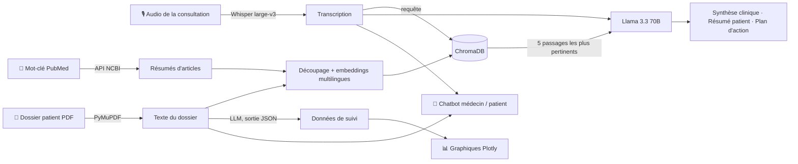

# 🩺 MedCair — Assistant IA pour l'analyse de consultations médicales

MedCair transforme l'enregistrement d'une consultation médicale en une synthèse clinique structurée, un résumé en langage simple pour le patient et un plan d'action personnalisé.

Il combine la **transcription automatique (speech-to-text)**, la **génération augmentée par recherche (RAG)** sur le dossier patient et des articles PubMed, et un **grand modèle de langage (LLM)**. Il propose aussi des graphiques de suivi du patient et un chatbot pour les médecins et les patients.

> ⚠️ **Avertissement :** MedCair est un prototype de recherche et d'apprentissage. Ce n'est **pas** un dispositif médical et il ne doit pas être utilisé pour poser un diagnostic ou décider d'un traitement. Toutes les données d'exemple de ce dépôt (audio et dossier patient) sont **fictives**.

---

## ✨ Fonctionnalités

- **Transcription de la consultation** : conversion d'un enregistrement audio (MP3, WAV ou M4A) en texte avec Whisper.
- **Lecture du dossier patient** : extraction du texte d'un dossier médical au format PDF.
- **Recherche d'articles médicaux** : récupération des résumés PubMed pertinents à partir d'un mot-clé, via l'API NCBI E-utilities.
- **Pipeline RAG** : découpage du dossier patient et des articles en passages, vectorisation avec un modèle multilingue, stockage dans ChromaDB et recherche des passages les plus pertinents pour la consultation.
- **Analyse par LLM**, qui produit trois résultats :
  1. une synthèse clinique structurée,
  2. un résumé en langage simple pour le patient,
  3. un plan d'action personnalisé, téléchargeable au format `.txt`.
- **Extraction de données structurées** : extraction des données de suivi au format JSON (tension artérielle, HbA1c, poids, traitements) et affichage en graphiques avec alertes de seuils.
- **Chatbot** à deux modes :
  - 🧑‍⚕️ **Médecin** : réponses techniques.
  - 🙋 **Patient** : explications simples et rassurantes.

---

## 🏗️ Architecture



---

## 🧰 Technologies

| Composant | Outil |
|---|---|
| Transcription audio | Whisper `whisper-large-v3`, via l'API Groq |
| LLM | Llama 3.3 70B (`llama-3.3-70b-versatile`), via l'API Groq |
| Embeddings | `paraphrase-multilingual-MiniLM-L12-v2` (Sentence-Transformers) |
| Base vectorielle | ChromaDB (en mémoire) |
| Extraction PDF | PyMuPDF |
| Articles scientifiques | PubMed / NCBI E-utilities |
| Visualisation | Plotly |
| Interface | Streamlit |

---

## 🚀 Installation

### 1. Cloner le dépôt

```bash
git clone https://github.com/AMINATA1999/MedCair.git
cd MedCair
```

### 2. Installer les dépendances

```bash
pip install -r requirements.txt
```

### 3. Ajouter votre clé API Groq

Créez un fichier `.env` à la racine du projet :

```
GROQ_API_KEY=votre_cle_api
```

Une clé gratuite peut être obtenue sur [console.groq.com](https://console.groq.com).

### 4. Lancer l'application

```bash
streamlit run app.py
```

L'application s'ouvre à l'adresse `http://localhost:8501`.

---

## 🖥️ Utilisation

1. Dans la barre latérale, chargez l'**audio de la consultation**. Ce fichier est obligatoire.
2. Si vous le souhaitez, chargez le **dossier patient (PDF)** et saisissez un **mot-clé PubMed**, par exemple `type 2 diabetes hypertension`.
3. Cliquez sur **🚀 Analyser**.
4. Parcourez les trois onglets :
   - **📋 Analyse** : transcription, passages retrouvés par le RAG, synthèse et plan d'action générés.
   - **📊 Suivi** : graphiques de suivi du patient.
   - **💬 Chatbot** : posez vos questions en mode médecin ou patient.

Le dépôt contient des fichiers d'exemple pour tester l'application : `consultation.mp3` et `dossier_medical_exemple.pdf`.

<!-- Ajoutez des captures d'écran ici, par exemple :


-->

---

## 📁 Structure du projet

```
MedCair/
├── app.py                     # Interface Streamlit
├── analyzer.py                # Transcription, RAG, analyse LLM, extraction, graphiques, chatbot
├── requirements.txt
├── MedCair_Presentation.pdf   # Présentation du projet
├── consultation.mp3           # Audio d'exemple (fictif)
└── dossier_medical 2.pdf      # Dossier patient d'exemple (fictif)
```

---

## ⚠️ Limites

- **Pas de validation clinique** : les résultats n'ont pas été évalués par des professionnels de santé.
- **Risques liés au LLM** : le modèle peut produire des informations inexactes ou incomplètes (hallucinations).
- **Seuils simplifiés** : les seuils d'alerte sont génériques (130/80 mmHg, HbA1c 7 %, IMC 25/30) et ne sont pas adaptés à chaque patient.
- **Confidentialité** : l'audio et le texte sont envoyés à une API externe (Groq). De vraies données patients nécessiteraient une installation conforme au RGPD, de préférence hébergée en interne.
- **Langue** : la transcription est configurée en français.

---

## 🛣️ Pistes d'amélioration

- [ ] Évaluer l'extraction JSON sur des dossiers fictifs annotés à la main (précision et rappel par champ).
- [ ] Évaluer la qualité de la transcription (taux d'erreur par mot, WER).
- [ ] Transmettre le contexte du RAG au chatbot.
- [ ] Calculer l'IMC à partir de la taille réelle du patient (actuellement fixée à 1,75 m).
- [ ] Permettre l'utilisation de modèles hébergés localement, pour la confidentialité.
- [ ] Ajouter la prise en charge d'autres langues (anglais, coréen).

---

## 👩‍💻 Autrice

**Ndeye Aminata Gadiaga**, Data Scientist / Ingénieure IA
[LinkedIn](https://linkedin.com/in/ndeye-aminata-gadiaga-26a97725b) · [GitHub](https://github.com/AMINATA1999)
